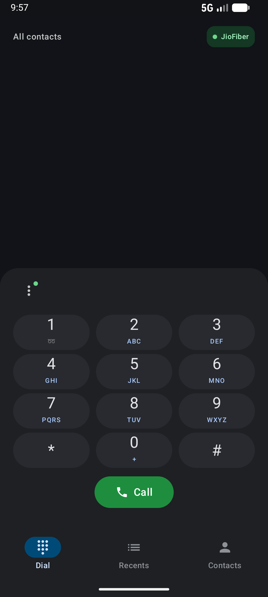
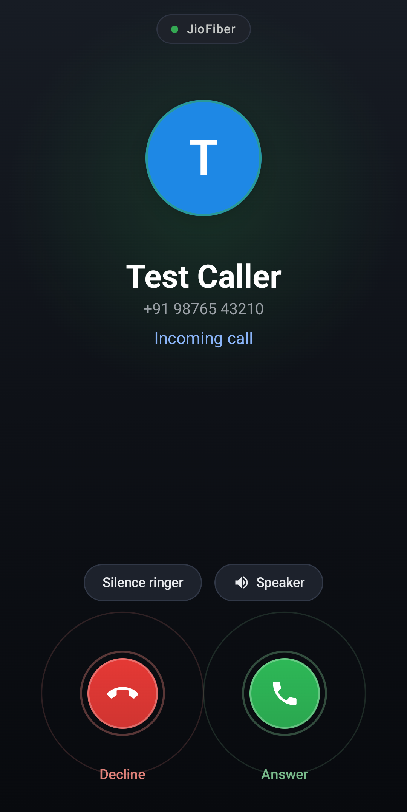
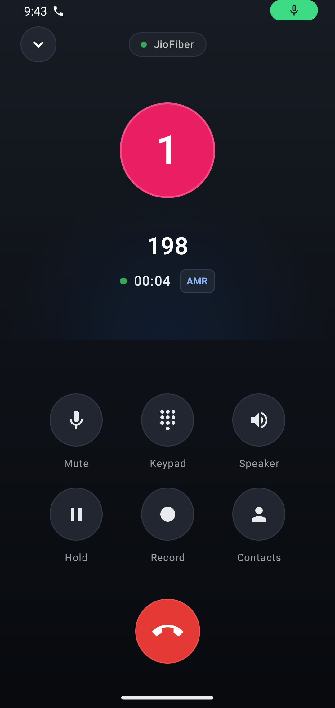
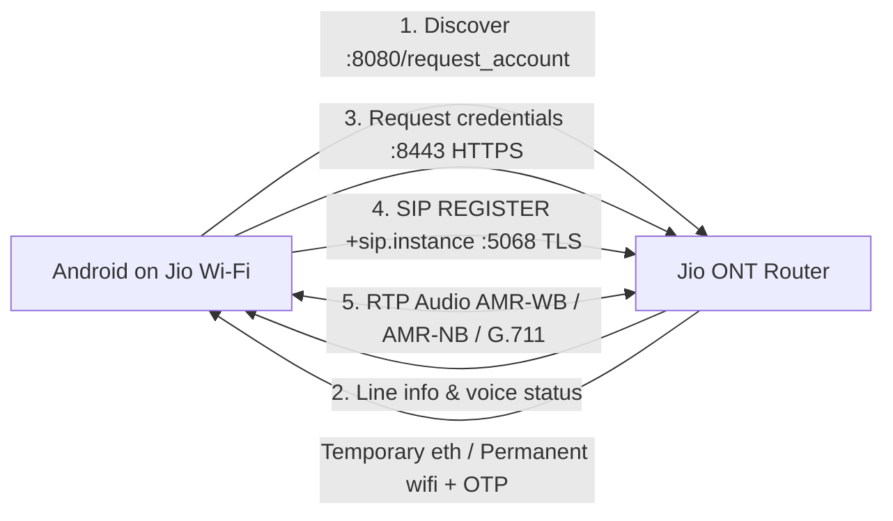

<div align="center">


# JioCall

**Native Android SIP / VoIP Dialer with Automatic JioFiber & JioAirFiber Provisioning**

*Open-source JioJoin alternative built in 100% pure Kotlin & Jetpack Compose — make and receive HD Voice (`AMR-WB`) landline calls from your Android phone over Wi-Fi.*

[](https://github.com/ap415274-cmyk/JioCall/releases/latest)
[](https://github.com/ap415274-cmyk/JioCall/releases)
[](https://github.com/ap415274-cmyk/JioCall/actions)
[](LICENSE)

[-3DDC84?style=flat-square&logo=android&logoColor=white)](app/build.gradle.kts)
[](gradle/libs.versions.toml)
[](gradle/libs.versions.toml)
[](#tech-stack--requirements)

[Download APK](#download--install) •
[Screenshots](#screenshots) •
[Features](#features) •
[How It Works](#how-jiofiber--jioairfiber-provisioning-works) •
[Build From Source](#build-from-source) •
[FAQ](#troubleshooting--faq)

</div>

---

> [!IMPORTANT]
> **Independent Open-Source Project:** JioCall is not affiliated with, endorsed by, or sponsored by Reliance Jio Infocomm Ltd. *"Jio"*, *"JioFiber"*, *"JioAirFiber"*, and *"JioJoin"* are trademarks of their respective owners and are mentioned strictly to describe compatibility with your local ONT router. Use only on your own router/voice line or authorized SIP server.

---

## Download & Install

1. Download the signed release APK from [**GitHub Releases**](https://github.com/ap415274-cmyk/JioCall/releases/latest) (or directly from [`releases/JioCall-v1.1-release.apk`](releases/JioCall-v1.1-release.apk)).
2. Install on Android **9.0 (API 28)** or newer.
3. Connect to your **JioFiber / JioAirFiber** Wi-Fi network, open the app menu -> **Connect JioFiber/AirFiber**, and choose:
   - **Temporary (`eth`)**: Instant setup with no OTP (credentials auto-renew when needed).
   - **Permanent (`wifi`)**: One-time OTP verification sent to your registered mobile number.
4. Or open **Accounts** to configure any standard **SIP (`UDP` / `TCP` / `TLS`)** PBX/VoIP provider.

---

## Screenshots

<div align="center">
<table>
  <tr>
    <td align="center"><b>T9 Dialer & Status</b></td>
    <td align="center"><b>Incoming Call Controls</b></td>
    <td align="center"><b>Active HD / AMR Call</b></td>
  </tr>
  <tr>
    <td></td>
    <td></td>
    <td></td>
  </tr>
</table>
</div>

---

## Features

### JioFiber & JioAirFiber Auto-Provisioning
- **Zero-config ONT discovery**: Automatically probes `jiofiber.local.html`, the active IPv4 default gateway, `192.168.29.1`, and `192.168.31.1` on port `8080` (`/request_account`) via raw ONT-compatible HTTP/HTTPS ([`JioRouter`](app/src/main/java/com/pp/jiocall/jio/JioRouter.kt), [`JioClient`](app/src/main/java/com/pp/jiocall/jio/JioClient.kt), [`RouterHttp`](app/src/main/java/com/pp/jiocall/jio/RouterHttp.kt)).
- **Both credential modes supported**: Instant **Temporary (`eth`)** credentials with automatic background renewal, or OTP-verified **Permanent (`wifi`)** registration.
- **Router whitelisting compliant**: Generates deterministic device MAC + `+sip.instance` UUID headers required by Jio ONT SIP proxies (`port 5068` over TLS).

### Pure Kotlin SIP & Real-Time VoIP Engine
- **Custom RFC 3261 signaling**: `UDP`, `TCP`, and `TLS` transports, MD5 Digest authentication, `REGISTER` refresh, NAT keep-alives, Hold, Call Waiting, Call Forwarding (`302`), Do Not Disturb (`486 Busy Here`), Caller ID hiding (`Privacy: id`), and Linksys/Cisco [`DialPlan`](app/src/main/java/com/pp/jiocall/sip/DialPlan.kt) rewrite rules.
- **HD Voice & Multi-Codec Support**: Negotiates **AMR-WB (`16 kHz`)**, **AMR-NB (`8 kHz`)**, **PCMA (`G.711 A-law`)**, and **PCMU (`G.711 μ-law`)** with single-codec SDP answering ([`MediaNegotiation`](app/src/main/java/com/pp/jiocall/sip/MediaNegotiation.kt), [`Sdp`](app/src/main/java/com/pp/jiocall/sip/Sdp.kt)).
- **RFC 4867 AMR Framing**: Full Bandwidth-Efficient (`BE`) and Octet-Aligned (`OA`) packing/unpacking with dynamic Codec Mode Request (`CMR`) adaptation ([`AmrFraming`](app/src/main/java/com/pp/jiocall/sip/AmrFraming.kt)).
- **Tuned Audio Pipeline**:
  - Deterministic Google Codec2 / OMX AMR `MediaCodec` selection ([`AmrCodec`](app/src/main/java/com/pp/jiocall/sip/AmrCodec.kt)) to prevent vendor hardware codec distortion.
  - Adaptive jitter buffer, waveform PLC, and cached Blackman-sinc resampler ([`RtpJitterBuffer`](app/src/main/java/com/pp/jiocall/sip/JitterBuffer.kt)).
  - Low-latency `AudioTrack` / `AudioRecord` streaming with direct codec-rate fallback when `FLAG_FAST` is unsupported ([`AudioPlaybackEngine`](app/src/main/java/com/pp/jiocall/sip/AudioPlaybackEngine.kt), [`AudioCaptureEngine`](app/src/main/java/com/pp/jiocall/sip/AudioCaptureEngine.kt)).
  - Hardware `AcousticEchoCanceler` & `NoiseSuppressor` ([`AudioEffectsController`](app/src/main/java/com/pp/jiocall/sip/AudioEffectsController.kt)), soft-knee gain limiter ([`AudioGain`](app/src/main/java/com/pp/jiocall/sip/AudioGain.kt)), RFC 2833/4733 DTMF, and local WAV recording ([`CallRecorder`](app/src/main/java/com/pp/jiocall/sip/CallRecorder.kt)).
  - Real-time ITU-T E-model MOS quality estimation ([`CallQuality`](app/src/main/java/com/pp/jiocall/sip/CallQuality.kt)).

### Dialer UX & Diagnostics
- **Material 3 Light & Dark Modes**: Clean 3-tab pager (`Dial`, `Recents`, `Contacts`) with fast Compose rendering.
- **T9 SmartDial & Number Formatting**: Instant contact/digit search with highlighted matches ([`SmartDial`](app/src/main/java/com/pp/jiocall/data/SmartDial.kt)), `libphonenumber` formatting, contact avatars, and WhatsApp shortcut (`com.whatsapp` / `com.whatsapp.w4b`).
- **System Call Integration**: Full-screen dark [`CallScreen`](app/src/main/java/com/pp/jiocall/ui/CallScreen.kt), swipe-to-answer/decline incoming controls ([`IncomingSlideControls`](app/src/main/java/com/pp/jiocall/ui/components/IncomingSlideControls.kt)), Android `CallStyle` notifications ([`CallService`](app/src/main/java/com/pp/jiocall/sip/CallService.kt)), ongoing-call banner, proximity wake lock, and `tel:` / `sip:` deep links.
- **Live SIP Packet Inspector**: Built-in [`DiagnosticsScreen`](app/src/main/java/com/pp/jiocall/ui/DiagnosticsScreen.kt) with TX/RX counters, filters, search, copy, and share.

---

## How JioFiber / JioAirFiber Provisioning Works



---

## Architecture

```text
app/src/main/java/com/pp/jiocall/
├── App.kt                        # Engine lifecycle, foreground watcher, credential refresh
├── MainActivity.kt               # Edge-to-edge Compose host, tel:/sip: intents, 3-tab UI
├── jio/                          # JioFiber / JioAirFiber ONT discovery & provisioning
│   ├── JioRouter.kt              # Host hash, MAC, +sip.instance UUID, XML/JSON parsing
│   ├── JioClient.kt              # Discovery candidates, temporary/permanent credentials & OTP
│   └── RouterHttp.kt             # Custom HTTP/1.1 & local HTTPS client for ONT endpoints
├── sip/                          # SIP signaling, SDP, codecs, RTP audio & foreground service
│   ├── SipEngine.kt / SipAccount.kt / SipTransport.kt / SipMessage.kt / Sdp.kt / Digest.kt
│   ├── MediaNegotiation.kt / DialPlan.kt / CallQuality.kt / SipLogBuffer.kt
│   ├── RtpAudio.kt / AmrCodec.kt / AmrFraming.kt / JitterBuffer.kt
│   ├── AudioPlaybackEngine.kt / AudioCaptureEngine.kt / AudioEffectsController.kt / AudioGain.kt
│   ├── CallAudioController.kt / CallRecorder.kt / ToneGenerator.kt
│   └── CallService.kt / CallActionReceiver.kt / BootReceiver.kt
├── data/                         # Persistence, SmartDial index, contact & phone helpers
└── ui/                           # Dialer, Recents, Contacts, CallScreen, Connect, Settings, Diagnostics
```

---

## Tech Stack & Requirements

| Component | Details |
| --- | --- |
| **Android SDK** | Min SDK `28` (Android 9.0) • Compile / Target SDK `37` |
| **Language** | Kotlin `2.2.10` • Java `11` bytecode target |
| **Build System** | Gradle `9.6.0` • Android Gradle Plugin `9.5.2` (R8 optimization enabled) |
| **UI & Async** | Jetpack Compose BOM `2026.02.01`, Material 3, Coroutines `1.9.0`, `libphonenumber` `9.0.44` |
| **Native Code** | **None** — compiles cleanly without Android NDK, CMake, C++, or Rust |

---

## Build From Source

### Clone & Build
```bash
git clone https://github.com/ap415274-cmyk/JioCall.git
cd JioCall

# Build debug APK
./gradlew assembleDebug

# Build minified release APK (auto-signs if keystore.properties or CI secrets are present)
./gradlew assembleRelease

# Install debug build on a connected device/emulator
./gradlew installDebug
```

On Windows PowerShell, use `.\gradlew.bat` with `JAVA_HOME` set to JDK 17+ / Android Studio JBR.

<details>
<summary>Optional: Release APK signing configuration (local & GitHub Actions)</summary>

- **Local signing**: create a gitignored `keystore.properties` in the repo root with `storeFile`, `storePassword`, `keyAlias`, and `keyPassword`.
- **GitHub Actions CI**: set repository secrets `RELEASE_KEYSTORE_BASE64`, `RELEASE_KEYSTORE_PASSWORD`, `RELEASE_KEY_ALIAS`, and `RELEASE_KEY_PASSWORD` so tagged releases (`v*`) sign and publish APKs automatically.

</details>

### Tests & Lint
```bash
# Run JVM unit tests (SIP, SDP, RFC 4867 AMR framing, JitterBuffer, SmartDial, JioRouter)
./gradlew testDebugUnitTest

# Run Android Lint
./gradlew lintDebug

# Run instrumented tests on a connected Android device/emulator
./gradlew connectedDebugAndroidTest
```

---

## Troubleshooting & FAQ

- **Router not discovered automatically?**
  Make sure your phone is connected directly to your JioFiber / JioAirFiber Wi-Fi LAN (not cellular data or an isolated guest Wi-Fi). If needed, enter your router gateway IP manually (commonly `192.168.29.1` or `192.168.31.1`) on the **Connect JioFiber/AirFiber** screen.
- **`403 Device not whitelisted` during SIP `REGISTER`?**
  Verify your account was provisioned via **Connect JioFiber/AirFiber** (or re-connect in **Accounts**). Jio ONTs validate the device's deterministic `+sip.instance` UUID header alongside temporary/permanent credentials.
- **No audio on a specific PBX / SIP server?**
  Open **Diagnostics** from the overflow menu to inspect negotiated SDP codecs and check codec preference order (`AMR-WB, AMR, PCMA, PCMU`) in **Settings**.

---

## Permissions

Declared in [`AndroidManifest.xml`](app/src/main/AndroidManifest.xml):
- **Network & Local Provisioning**: `INTERNET`, `ACCESS_NETWORK_STATE`, `ACCESS_WIFI_STATE` (cleartext HTTP restricted in [`network_security_config.xml`](app/src/main/res/xml/network_security_config.xml) solely to local ONT endpoints `jiofiber.local.html`, `192.168.29.1`, `192.168.31.1`, and localhost/emulator).
- **Audio & Calls**: `RECORD_AUDIO`, `MODIFY_AUDIO_SETTINGS`, `BLUETOOTH_CONNECT`, `WAKE_LOCK`, `VIBRATE`, `MANAGE_OWN_CALLS`.
- **Contacts & Background Reliability**: `READ_CONTACTS`, `POST_NOTIFICATIONS`, `USE_FULL_SCREEN_INTENT`, `FOREGROUND_SERVICE*`, `RECEIVE_BOOT_COMPLETED`.

---

## Contributing & License

Contributions, bug reports, and device compatibility feedback are welcome via Issues and Pull Requests!

Licensed under the [**Apache License, Version 2.0**](LICENSE) — see [`LICENSE`](LICENSE) and [`NOTICE`](NOTICE).
